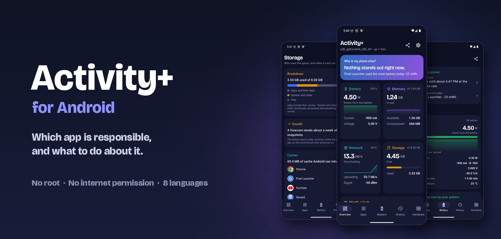
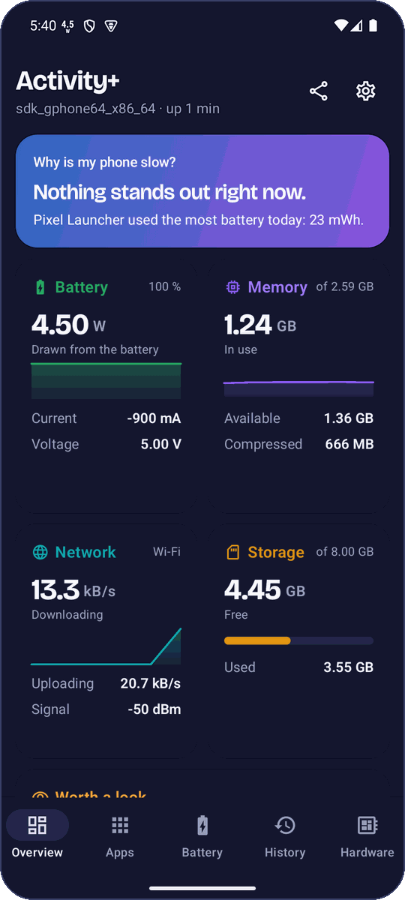
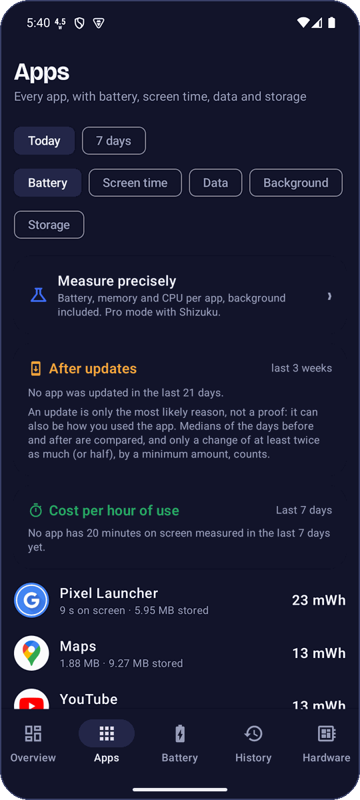
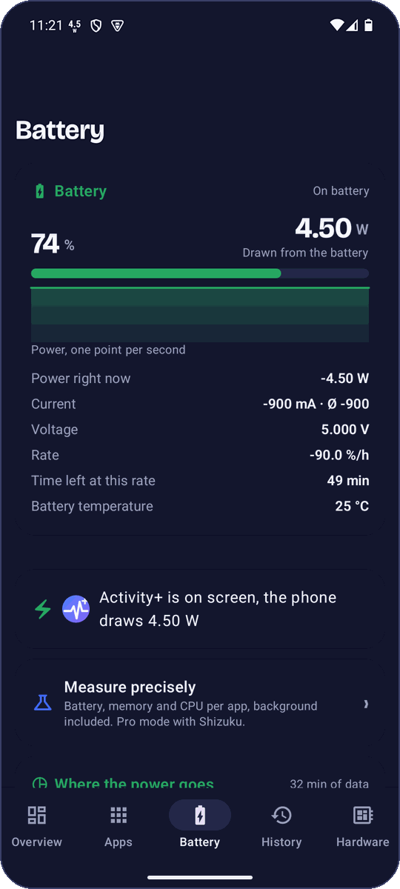
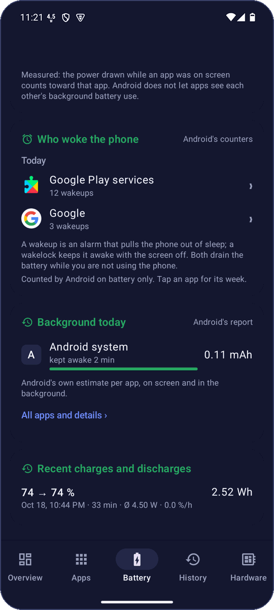
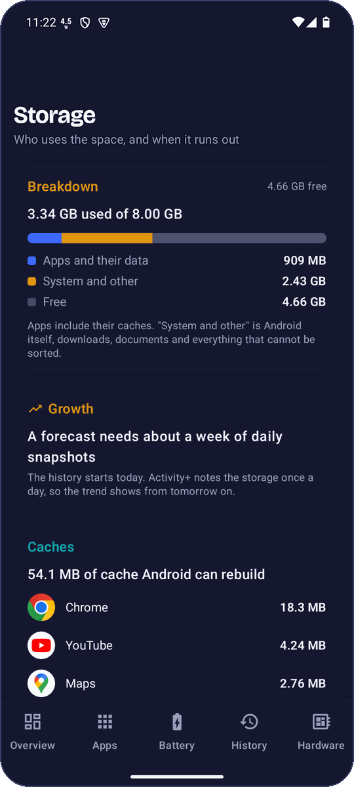
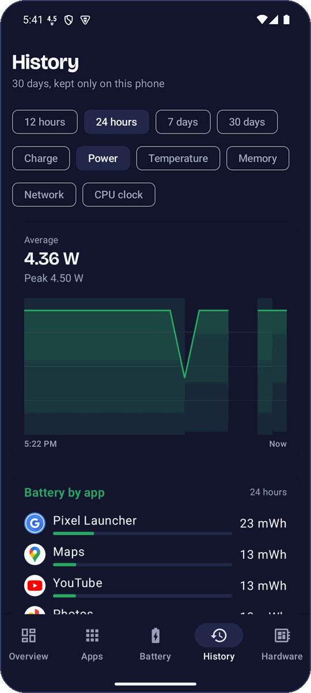
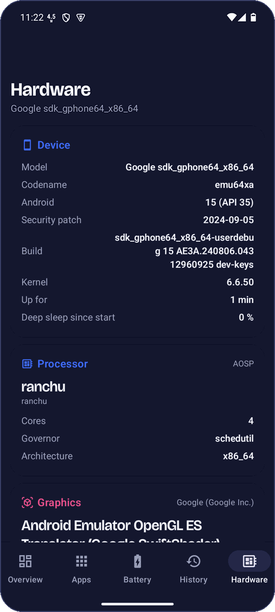
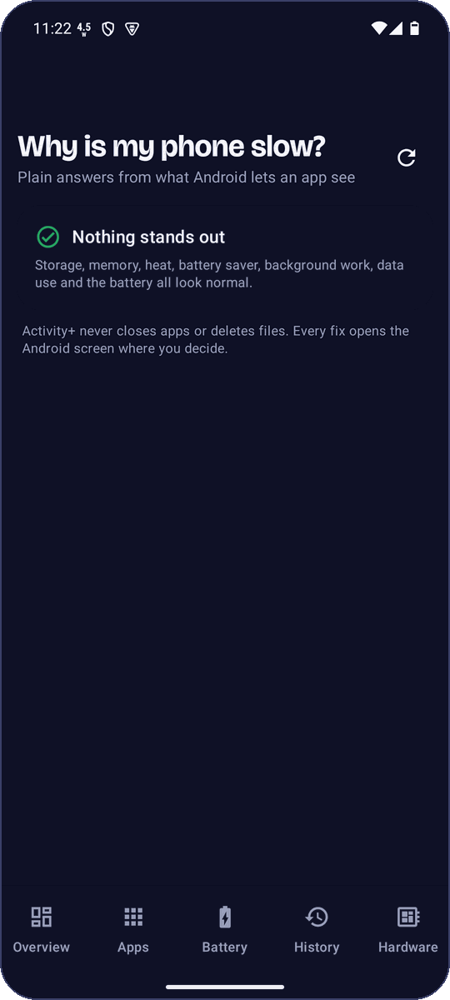

<p align="center"></p>

<p align="center">
  <a href="https://activityplus.xyz/#android"><b>Download</b></a> &nbsp;·&nbsp;
  <a href="docs/SETUP.md"><b>Setup guide</b></a> (<a href="docs/SETUP.de.md">Deutsch</a>) &nbsp;·&nbsp;
  <a href="https://github.com/robbyczgw-cla/activity-plus-android/releases">Releases</a> &nbsp;·&nbsp;
  <a href="https://apps.obtainium.imranr.dev/redirect.html?r=obtainium://add/https://github.com/robbyczgw-cla/activity-plus-android">Add to Obtainium</a> &nbsp;·&nbsp;
  <a href="https://github.com/robbyczgw-cla/activity-plus">Mac version</a>
</p>

<p align="center">
  
  
  
  
</p>

# Activity+ for Android

**A system monitor for Android that tells you which app is responsible, and what to do about it.**

The Android sibling of [Activity+ for Mac](https://github.com/robbyczgw-cla/activity-plus). Your battery drains
overnight, the phone gets warm, storage is full: Activity+ names the app behind it and takes you to the Android
screen that fixes it. It never closes apps or deletes anything on its own, has no internet permission, and keeps
everything on the phone. Native Kotlin and Jetpack Compose, Android 10 or later, in eight languages.

<p align="center">
  &nbsp;
  &nbsp;
  &nbsp;
  
</p>

## Download

- **APK** from [activityplus.xyz](https://activityplus.xyz/#android) or the [GitHub releases](https://github.com/robbyczgw-cla/activity-plus-android/releases),
  each with its SHA-256.
- **Updates** with [Obtainium](https://apps.obtainium.imranr.dev/redirect.html?r=obtainium://add/https://github.com/robbyczgw-cla/activity-plus-android),
  straight from the GitHub releases.
- Signing certificate SHA-256: `07:38:FA:A1:25:50:6A:DD:65:72:8D:08:7D:DB:AE:79:CB:A8:C2:AD:87:B3:96:C0:CC:8D:15:03:32:51:C3:C1`

After installing, Activity+ asks for usage access (to see apps) and notifications (for the live status).
The [setup guide](docs/SETUP.md) explains everything else, including how to keep it measuring on phones
that stop apps in the background.

## What it does

### Which app is responsible
- **Overview** with a verdict that names one app and the next step, and live cards in the Mac colors.
- **Night check** every morning: did the phone sleep well? Deep sleep, Doze and drain against your usual nights,
  and who is to blame: an app, Android itself, or a weak signal.
- **Since the update**: what changed for an app after it was updated.
- **Apps**: battery (measured while on screen), screen time, data with the background share and storage,
  one row per app, with "unusual for this app" when one uses far more than on a normal day.
- **Why slow?** Plain-language findings, each with a button into the Android screen that fixes it.
- **Weekly report** every Monday: the apps with the most battery, screen time and data against the week before.

### Battery, precisely
- Power in watts, averaged and live, current next to voltage, percent per hour, time to full or empty.
- Sessions from plug to unplug, a 30-second **charger and cable test**, the measured capacity as a trend.
- **Charge alarms** at a limit such as 80 %, when full and when the battery gets warm while charging.
- **Charging as a Live Update** on Android 16: level, power and "full at" in the status bar.
- **Remaining time by your pattern**, **charging habits** with advice and an ageing forecast, cost per hour of use per app.
- **Heat and throttling**: when Android slowed the phone down, and which app was on screen.

### Storage
- Breakdown, **growth per app** and "storage full in about N days".
- Caches, unused apps, large and old media, duplicates. Deleting only through Android's own dialog.
- A storage speed test.

<p align="center">
  &nbsp;
  &nbsp;
  &nbsp;
  
</p>

### Always in view
- A live value as the **status bar icon**, up to eight values in the notification, a Quick Settings tile.
- **Widgets**: one value, a panel with six values, a battery ring, the night check, a 6-hour history graph.
- **Share** a report as text or image, **export** your data as CSV and JSON.
- **Alerts** that name the cause: heat, full storage, a charger too weak for the load, an app drawing a lot of power.
- **History**: 30 days on the phone, one point per minute; tap a point to see the app that was on screen.
- **Hardware**: chip with live clock per core, GPU, memory split, display modes, cameras, sensors.

### Pro diagnosis (optional)
Android keeps some things from normal apps. With a one-time grant from a computer, or with
[Shizuku](https://shizuku.rikka.app/), Activity+ can also show:

| | Computer grant | Shizuku |
|---|---|---|
| Background battery per app, every day, and a "Last night" card | yes | yes |
| **Who woke the phone**: wakeups, wakelocks, CPU and jobs per app | yes | yes |
| **Battery passport**: state of health, manufacturing date, charging policy | yes | yes |
| **Planned for tonight**: alarms and jobs per app, exact alarms that ignore Doze | yes | yes |
| **Sensor log**: who used location, camera, microphone, and in the background | yes | no |
| Memory and CPU per app | no | yes |
| Developer options afterwards | off, permanently | needed while you measure |

Banking and ID apps keep working: the grant stays after you turn developer options off again. Power per
component (display, CPU, GPU, radio) comes from Android's own power meters on Android 15 and newer, without
any grant, on phones that have them. How to set it all up: [setup guide](docs/SETUP.md#4-pro-mode-optional).

### Private by design
No internet permission, no account, no analytics, no ads. Everything stays in the app's own data on the phone.

## Build and test

Needs JDK 17+ and the Android SDK (platform 36). Put `sdk.dir=/path/to/sdk` in `local.properties`.

```bash
./gradlew :app:testDebugUnitTest      # unit tests: formatting, fuel gauge quirks, drain split, diagnosis, dumpsys parsers
./gradlew :app:assembleRelease        # unsigned unless the release signing properties below are set
python3 -I scripts/l10n-check.py      # every translation against values/strings*.xml
scripts/emu.sh start && scripts/emu.sh install && scripts/emu.sh smoke   # emulator smoke test
```

Release signing reads `activityplus.storeFile`, `activityplus.storePassword`, `activityplus.keyAlias` and
`activityplus.keyPassword` from `~/.gradle/gradle.properties`, so no key or password lives in the repo.
Research behind the design choices: [`docs/research/`](docs/research/).

## License

MIT, see [LICENSE](LICENSE). The Bricolage Grotesque font is under the SIL Open Font License, see
[FONT-LICENSE-OFL.txt](FONT-LICENSE-OFL.txt).
